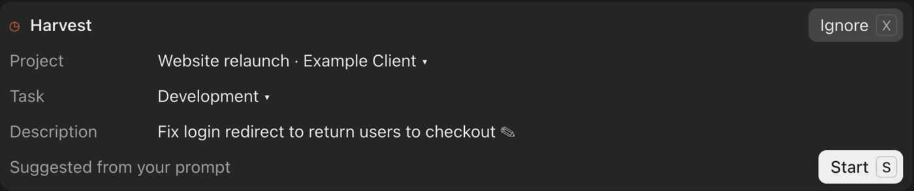
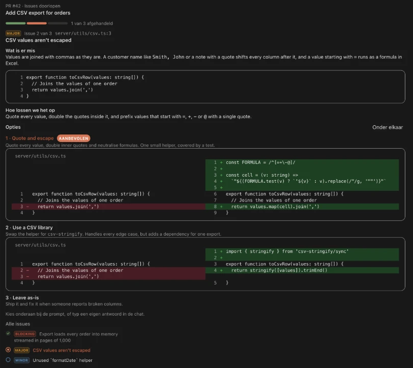
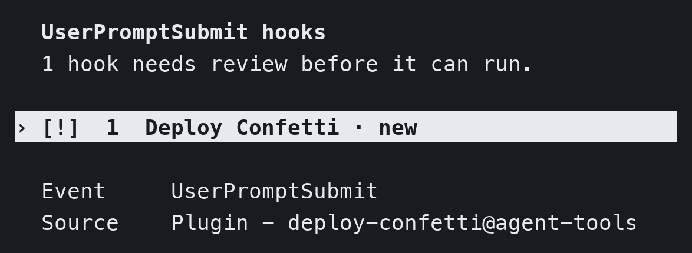

# agent-tools

Personal library of AI agent tools: **skills** (reusable instructions that extend Claude, Codex, and other skill-aware agents with my own workflows and conventions) and **Claude Code mods** (plugins that change Claude Code's own interface and behaviour).

---

## What is a Skill?

A skill is a small package that loads context and instructions into an AI agent on demand. When a task matches a skill's description, the agent pulls in the relevant knowledge — conventions, step-by-step workflows, reference material — without it needing to be re-explained every time.

Skills live in `.agents/skills/<name>/` inside a project, or globally in `~/.agents/skills/` (or the agent's own global skills directory, e.g. `~/.claude/skills/` for Claude Code).

---

## Available Skills

| Skill | Description | Install |
|-------|-------------|---------|
| `tim-pr-review` | Tim's PR review points: the `9to5-web-dev` conventions plus correctness, security, overengineering and missing backend support. Review instructions for the `pr-review-hud` mod: `/pr-review-hud :tim-pr-review <PR>`. | `npx skills add tdebooij/agent-tools@tim-pr-review` |

> New skills added to this repo will appear here.

---

## Available Mods

Mods are Claude Code plugins, installed from this repository's plugin marketplace.



| Mod | Description | Install |
|-----|-------------|---------|
| [`harvest-live`](mods/harvest-live) | Harvest time tracking above the prompt: suggests a project, task and description from the first prompt of each new chat and starts the timer in one press. Connect your Harvest account from the band with one pasted token. | `/plugin install harvest-live --marketplace tdebooij/agent-tools` |
| [`pr-review-hud`](mods/pr-review-hud) | Interactive PR review: explains the PR, gives a verdict (including "redo"), then walks through issues one at a time with side-by-side diffs and option buttons in the side pane and above the prompt. Add your own review points in `~/.claude/pr-review.md`, a repo's `.claude/pr-review.md`, or a skill. | `/plugin install pr-review-hud --marketplace tdebooij/agent-tools` |



In the Claude desktop app, where `/plugin` doesn't run: click **+** next to the prompt box, then **Plugins**, **Add marketplace** with `tdebooij/agent-tools`, then **Add plugin**. From a shell: `claude plugin install <mod> --marketplace tdebooij/agent-tools`.

Update installed mods with `claude plugin marketplace update agent-tools`, then `claude plugin update <mod>@agent-tools`. See each mod's README for setup.

---

## Codex desktop plugins

[Harvest Live](plugins/harvest-live) offers an editable Harvest timer at the first in-hours message each day in a chat. Connect your own Harvest account and choose your working hours in the card.

```sh
codex plugin marketplace add tdebooij/agent-tools
codex plugin add harvest-live@agent-tools
```

[Deploy Confetti](plugins/deploy-confetti) celebrates a confirmed production rollout with emoji Codex picks for that release. The plugin README includes installation and hook setup.



---

## Installing a Skill

Skills are installed using the [`skills` CLI](https://skills.sh):

```bash
npx skills add tdebooij/agent-tools@<skill-name>
```

### Project-level install

Installs into the current project so the skill is versioned alongside the repo:

```bash
cd your-project
npx skills add tdebooij/agent-tools@tim-pr-review --agent universal --yes
```

### Global install

Installs the skill for every project on this machine:

```bash
npx skills add tdebooij/agent-tools@tim-pr-review -g
```

### Keeping skills up to date

```bash
# See which installed skills have updates available
npx skills check

# Update everything
npx skills update
```

Re-running `add` on an installed skill replaces the local copy with the latest version from this repo.

---

## Repository Structure

```
agent-tools/
├── .claude-plugin/
│   └── marketplace.json      ← lists the mods for /plugin install
├── mods/
│   └── <mod-name>/           ← one Claude Code plugin per folder
└── .agents/
    └── skills/
        └── <skill-name>/
            ├── SKILL.md          ← required: frontmatter + instructions
            ├── scripts/          ← optional: helper scripts
            ├── references/       ← optional: reference docs loaded on demand
            └── assets/           ← optional: templates, images, boilerplate files
```

Every skill has a `SKILL.md` with a YAML frontmatter block:

```yaml
---
name: skill-name
description: "What this skill does and when the agent should use it."
---
```

The directory name and frontmatter `name` must match. The `description` is the primary trigger — it should match the kinds of questions or tasks that make the skill relevant.

---

## Adding a New Skill

1. Scaffold it with the `skill-creator` skill (`npx skills add skill-creator -g`, then ask your agent to create a skill), or write `SKILL.md` by hand.
2. Place it at `.agents/skills/<skill-name>/`.
3. Add a row to the [Available Skills](#available-skills) table above.
4. Commit and open a PR.

---

## Getting Help

- **Browse the open skills ecosystem:** [skills.sh](https://skills.sh)
- **Search for existing skills:** `npx skills find [query]`
- **Skills CLI docs:** `npx skills --help`
