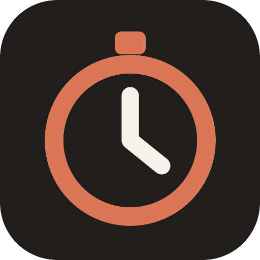
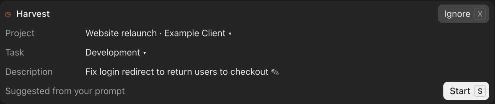

# harvest-live

A Claude Code mod that keeps your [Harvest](https://www.getharvest.com) timer next to your work. On the first prompt of every new chat during working hours it opens a small band above the prompt, lets Claude pick the Harvest project, task and a short description from what you asked, and starts the timer when you press **Start**.



<sub>Shown in demo mode with made-up projects.</sub>

## What it does

- **First prompt of each new chat** during your working hours (Monday to Friday, 9:00–18:00 unless you change them), and again the next day in a chat you keep using: the band opens and Claude suggests a project, task and description in the background. Your turn is never held up. Put `--no-harvest` anywhere in a prompt to keep the band closed for the rest of that chat today; the flag is taken out before Claude sees your prompt.
- **One spinner while it decides**, then the filled-in rows. Click a value to change it; your choice always wins over a late suggestion.
- **Start** creates a running time entry in Harvest. If a timer is already running, the button says **Switch** and stops that one first.
- **`/harvest`** opens the band any time; `/harvest <what you're doing>` gets a suggestion for that text; `/harvest refresh` refetches your projects and tasks (they're cached for a day). If you already have a skill or command called `harvest`, the mod's command is `/harvest-live` instead.
- Claude can tell the band what the work is once it has read the linked ticket or issue, so the suggestion gets better as the conversation goes.

## Install

Requires Claude Code 2.1.325 or newer (`claude update`).

At the prompt of a terminal session:

```
/plugin install harvest-live --marketplace tdebooij/agent-tools
```

Answer `y` to add the marketplace, then pick a scope (user is the usual one).

From a shell:

```bash
claude plugin install harvest-live --marketplace tdebooij/agent-tools
```

In the Claude desktop app: click **+** next to the prompt box, then **Plugins**, **Add marketplace** with `tdebooij/agent-tools`, then **Add plugin**.

## Connect your Harvest account

The mod talks to the Harvest API directly with your own personal access token; it doesn't need a Harvest MCP server or CLI.

The first time the band opens it shows **Connect Harvest**:

1. Click **Open Harvest's token page**, then **Create new personal access token** on that page.
2. Copy the token and paste it into the band. Press Enter.
3. The mod checks the token with Harvest and finds your account by itself (if you have several, it asks which one). The band then switches to the timer.

The token is saved in Claude Code's secure storage (it runs `claude plugin configure` for you), so you connect once. If `claude` isn't on your `PATH`, the band says *for this session only* and you connect again next session.

You can also set it from a shell, with the token on your clipboard:

```bash
pbpaste | jq -Rc '{harvestToken: .}' | claude plugin configure harvest-live@agent-tools --values-stdin
```

`claude plugin configure harvest-live@agent-tools` shows what's set. The account ID is found from the token when it's left empty.

The token can do anything your Harvest user can. The mod only reads your project assignments, your running timer, and creates or stops your own time entries.

## Working hours

The band only opens by itself during your working hours. Change them in `/config`, under the harvest-live rows:

| Setting | Default | |
|---|---|---|
| Working days | Monday to Friday | Also *Monday to Saturday*, *Every day*, or *Never* to only open it with `/harvest` |
| Working hours start | `09:00` | 24-hour `HH:MM` |
| Working hours end | `18:00` | 24-hour `HH:MM`; `24:00` for the end of the day |

Or from a shell: `echo '{"workStart": "08:00", "workEnd": "17:00"}' | claude plugin configure harvest-live@agent-tools --values-stdin`. `/harvest` works at any time.

## Demo mode

Turn on **Demo mode** to try the band without a Harvest account: it shows made-up projects and starts pretend timers, and sends nothing to Harvest.

```bash
echo '{"demo": true}' | claude plugin configure harvest-live@agent-tools --values-stdin
```

Set it back to `false` to use your real account.

## In T3 Code

T3 Code runs Claude Code through the Agent SDK and draws no band, but it does draw MCP App cards. So under T3 Code this mod shows the [Codex Harvest Live card](../../plugins/harvest-live) instead:

- The plugin ships that card's server in `t3-card/` as the `harvest-card` MCP server. It lists its tools only when `CLAUDE_CODE_ENTRYPOINT` is `t3-code`, so the Claude Code terminal and desktop app never see them and keep the band.
- On the first in-hours prompt of the day, Claude opens the card instead of the band. `/harvest` asks Claude to open it. `--no-harvest` works as before.
- The card keeps its own account, shared with the Codex plugin (`~/.config/harvest-live` and the macOS Keychain), not this mod's `harvestToken`. Connect once in the card. When the day's card opens is decided by this mod's working hours; the card's own working-hours view sets the Codex schedule.

`t3-card/` is a copy of `plugins/harvest-live`. After changing the card there, run `node mods/harvest-live/t3-card/sync.mjs` (`--check` reports a stale copy).

## Privacy

This is an independent project, not made or endorsed by Harvest.


Your prompt text, the current folder's path and your Harvest project and task names are sent to Claude (Sonnet and Haiku) to make the suggestion. Nothing is sent anywhere else besides the Harvest API.

## Develop

```bash
claude plugin validate mods/harvest-live
claude plugin test mods/harvest-live
```
