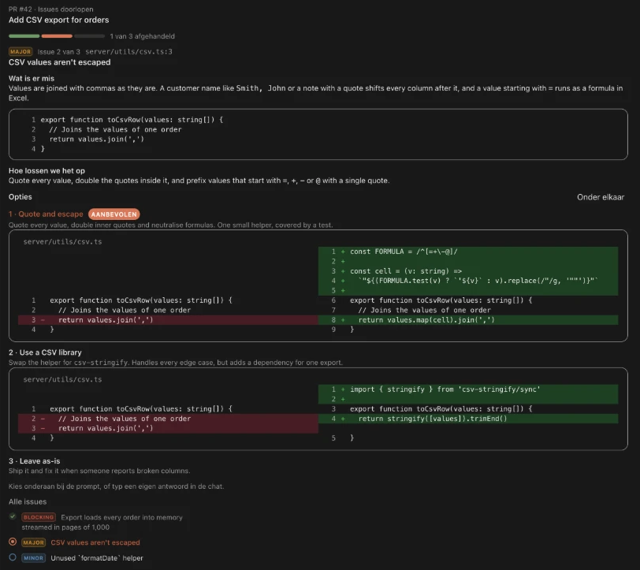
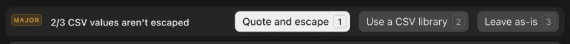

# pr-review-hud

An interactive pull request review in Claude Code. Claude explains what the PR is for, gives a verdict, then walks you through the issues one at a time. You read each issue with its diffs and pick a fix with one click.



Pick a fix in the bar above the prompt, or type your own answer in the chat:



## What it does

- **Explains the PR**: what problem it addresses and how it solves it.
- **Gives a verdict**: ready to merge, fix the issues first, or better redone from scratch.
- **Goes one issue at a time**, blocking → major → minor. Each issue says what's wrong, shows the code, explains how to fix it, and offers 2-4 fix options, each code-changing one with its diff.
- **You pick, Claude implements**: click an option, or type your own answer in the chat. Claude makes the change and moves to the next issue.

On the Claude desktop app you read the issue in the side pane, with side-by-side diffs (or stacked, one click away), and pick in a bar above the prompt. The chat keeps one line per issue as history. On the terminal the issue is a card in the chat.

## Install

```
/plugin install pr-review-hud --marketplace tdebooij/agent-tools
```

In the desktop app: click **+** next to the prompt box, then **Plugins**, **Add marketplace** with `tdebooij/agent-tools`, then **Add plugin**.

## Usage

```
/pr-review-hud 123                    # review PR 123
/pr-review-hud                        # review the current branch
/pr-review-hud :my-review 123         # add your own review skill
/pr-review-hud ./review-rules.md 123  # add a Markdown file
/pr-review-hud open                   # show the HUD
/pr-review-hud clear                  # reset the HUD
```

A PR number, a branch name or a GitHub PR link all work.

## Use your own review points

The plugin decides **how** a review runs. You decide **what** it checks. Your points are added on top of the defaults; they never replace them unless you say so.

There are three places to put them, and they stack:

| Where | For | Picked up |
| --- | --- | --- |
| `~/.claude/pr-review.md` | your personal points, in every repository | automatically |
| `.claude/pr-review.md` in a repository | the team's points for that project, committed with the code | automatically |
| a skill or `.md` file | a set you want for some reviews only | when you name it: `/pr-review-hud :my-review 123` |

### A review file

Plain Markdown. Write what you'd tell a reviewer:

```markdown
# Our review points

- We use Vue 3 with `<script setup lang="ts">`. Flag Options API in new components as major.
- Every user-facing string goes through i18n. A hard-coded string is major.
- Flag overengineering: a new abstraction used once is at least minor.
- Don't ask for tests on prototype branches (`proto/*`).
```

The last line shows how to switch a default off: say so explicitly.

### A review skill

If you already have a review skill, name it and its review points are used:

```
/pr-review-hud :my-review 123
```

A skill can also load further skills, such as your team's coding standards. A minimal one:

```markdown
---
name: my-review
description: My team's review points for web pull requests.
---

Load the `web-standards` skill and check the diff against it first.

Also flag:
- Missing loading and error states in new data-fetching components.
- Analytics events sent before cookie consent.
```

Only the review points are used. If your skill also says how to present findings (ask questions one by one, open panes, write a summary), the plugin's own flow replaces those steps.

## What the defaults check

These always apply ([`skills/review/default-instructions.md`](skills/review/default-instructions.md)):

1. **The repository's own rules**: `AGENTS.md`, `CLAUDE.md`, `CONTRIBUTING.md`, and the linters, formatters and tests already set up. Breaking a written rule is at least major.
2. **Correctness**: logic errors, unhandled empty, loading, error and null states, off-by-one, races, wrong assumptions about input.
3. **Security**: injection, unsafe HTML, secrets in code or logs, missing authorization, data sent where it shouldn't go. A real security issue is blocking.
4. **Does it solve the problem?** What the PR claims compared with what the diff does. A fix that doesn't fix counts towards a redo verdict.
5. **Simplicity**: abstractions nobody asked for, premature generalization, complexity that isn't earning its place.
6. **Fit**: reusing the code and patterns that are already there, naming and structure consistent with the code around it.
7. **Tests**: changed behavior has a test where the repository tests that area. No coverage targets.
8. **Backend gaps**: a client working around something the server should provide is flagged for the backend team, not patched over.

For documentation PRs, every claim is checked against the source it describes. Formatting a formatter would fix and personal style preferences are left out.

Findings are classified as **blocking** (must be fixed before merge), **major** (should be fixed) or **minor** (worth flagging, not blocking).

## What's fixed and what you change

| Part | Where | You change it |
| --- | --- | --- |
| HUD, side pane, bar above the prompt, chat cards, diffs, option buttons | the mod (`hooks/`) | no |
| How a review runs: verdict, one issue at a time, options with diffs, waiting for your pick | `skills/review/SKILL.md`, and rules the mod sends with every prompt while a review runs | no |
| What is checked | the defaults above, plus your own points | yes, by adding points |

The mod also refuses to show an issue without at least two options, so the one-at-a-time flow holds whatever the review points say.
