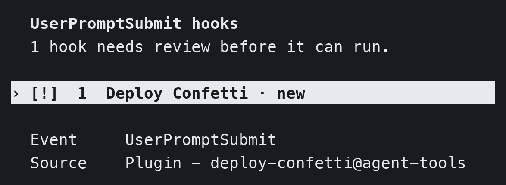

# Deploy Confetti

When Codex merges a PR into `main` or `master`, or you ask it to follow that release, it watches for the merged commit to finish deploying to production. Once the rollout is confirmed, the open Codex desktop window celebrates once. Codex picks emoji from the product or the change that shipped. If nothing fits naturally, you get the app’s default confetti.

## Install

Use Codex desktop with the built-in confetti tool and Python 3 on your PATH. The GitHub.com Actions verifier also uses an authenticated GitHub CLI with read access to the PR and workflow run.

```sh
codex plugin marketplace add tdebooij/agent-tools
codex plugin add deploy-confetti@agent-tools
```

Review and trust **Deploy Confetti** in the Codex CLI’s `/hooks` menu.



In your personal Codex instructions, give the desktop tool permission to celebrate future releases, for example:

> When a release you merge or follow is confirmed live in production, fire confetti once. Choose emoji for that release or use the default confetti.

Start a new desktop chat and ask Codex to follow a production release. If you previously installed the standalone hook, enable only one copy.

## What counts as live?

Codex checks the merge SHA, production workflow, successful publish step and completed run. For a pipeline that starts a separate rollout, it also waits for the provider to confirm the deployed revision is live. Other CI providers can supply equivalent evidence. The hook follows releases during the chat and respects the app’s reduced-motion setting.
